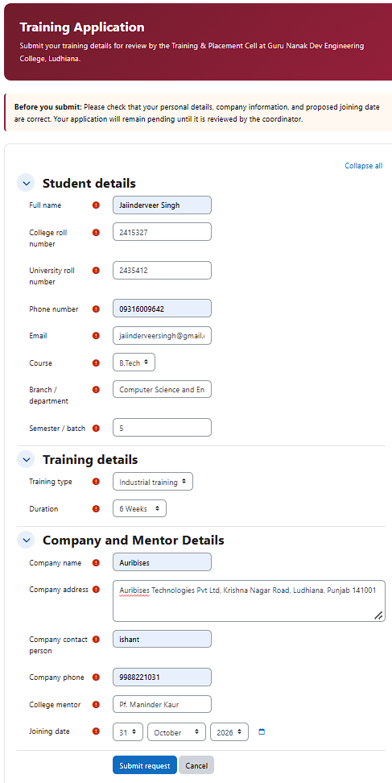
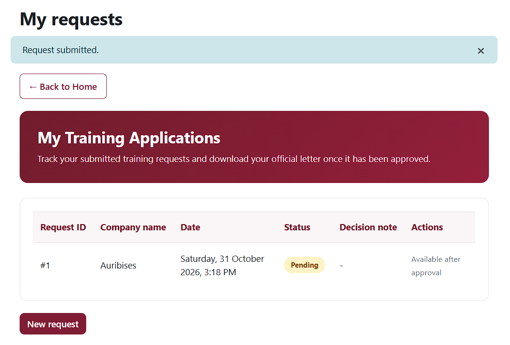
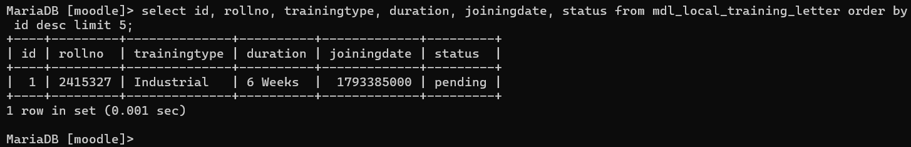
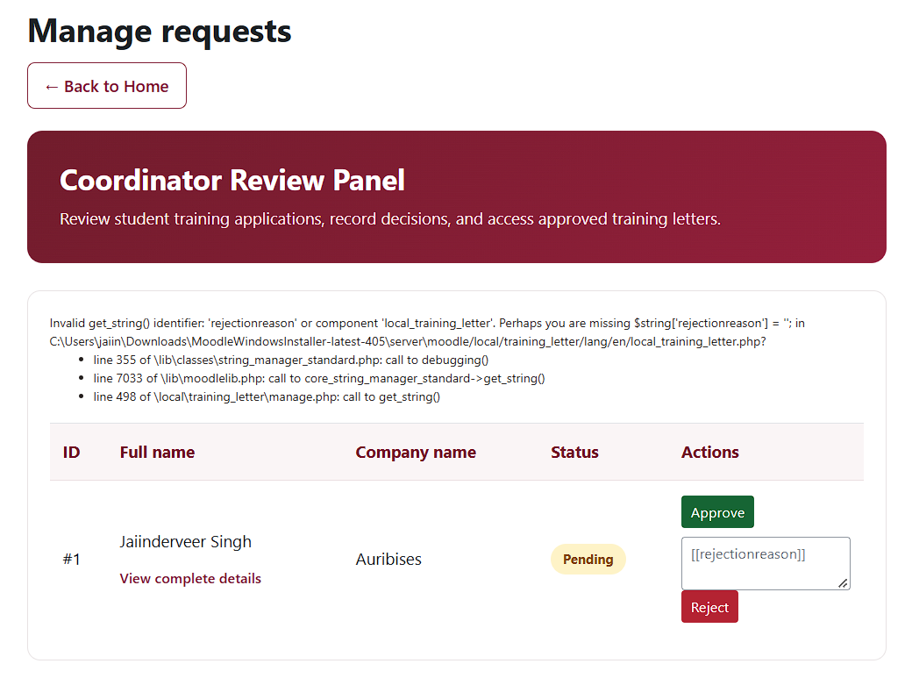
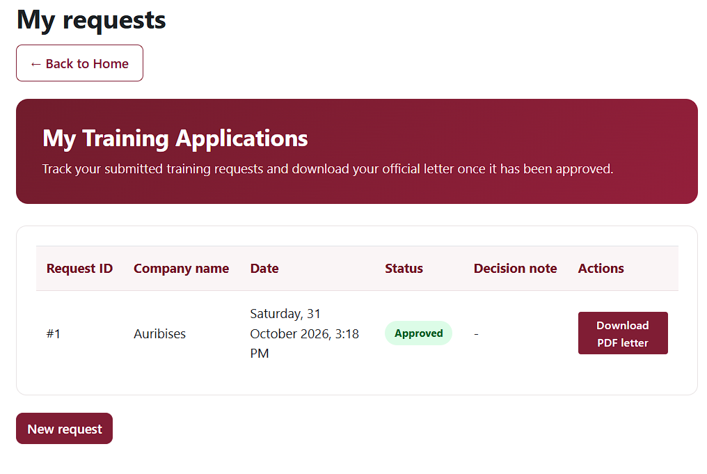

# GNDEC Training Letter — Moodle Local Plugin

A Moodle local plugin for submitting, reviewing, and managing student training-letter requests at **Guru Nanak Dev Engineering College (GNDEC), Ludhiana**.

The plugin implements a student-to-coordinator workflow: students submit training details, coordinators approve or reject requests, and students can download a generated PDF letter after approval.

> **Important:** The generated PDF is a software-generated draft. It is not an officially signed or issued GNDEC letter. Confirm the wording, reference-number convention, letterhead, signatory, and authorization process with GNDEC before official use. Use dummy data during testing and demonstrations.

## 1. Project overview

### Objectives
- Provide students with an online form for submitting training-letter requests.
- Validate submitted information and supported course/training combinations.
- Store requests and their status in Moodle's database.
- Allow authorized coordinators to review, approve, or reject requests.
- Show rejection reasons to students where a rejection reason has been supplied.
- Generate a PDF letter only for an approved request.

### User roles
| Role | Main actions |
|---|---|
| Student / authenticated user | Submit a request, view own applications and status, read a rejection reason, download an approved letter |
| Coordinator / manager | View submitted requests, inspect request details, approve or reject pending requests, provide a rejection reason |

## 2. Features implemented

### Student workflow
- Training request form for personal, academic, company, and mentor details.
- Course, training type, and duration selections with server-side validation of supported combinations.
- Student application list showing the student's own requests and their current status.
- Rejection reason displayed for a rejected request when a reason was entered by the coordinator.
- Approved-letter download; a pending or rejected request cannot be used to generate the letter.

### Coordinator workflow
- Separate coordinator review page protected by the `local_training_letter:manage` capability.
- Review of submitted request details and current status.
- Approve or reject actions for pending requests.
- Rejection reason captured as a coordinator note and shown to the student.
- Decision metadata records the coordinator and decision timestamp.
- Decision submissions use POST and Moodle session-key validation.
- A request that has already been reviewed cannot be decided again through the normal workflow.

### PDF generation
The generator uses Moodle's PDF library and selects a supplied letter format for supported combinations. It checks that the request is approved and that required student/training details are present before generating the PDF.

Supported formats currently handled in `letter.php`:
- B.Tech — six-week industrial training.
- B.Tech — six-month industrial training.
- B.Tech — software training.
- MBA — 6–8 week summer training.
- MCA — six-month industrial training.

Only combinations supported by a supplied format are accepted. Do not assume that other combinations have a valid letter template.

## 3. Requirements
- Moodle **4.5.x** or a compatible later version.
- PHP and database versions supported by the Moodle installation.
- Moodle administrator access for installation and plugin upgrades.
- The GNDEC logo asset expected at `pix/gndec_logo.png` for PDF generation.

The plugin declares Moodle 4.5 as its minimum required version in `version.php`.

## 4. Installation
1. Download or clone this repository.
2. Copy the plugin directory into `<moodle-root>/local/training_letter/`.
3. Confirm that `version.php` exists in that directory.
4. Confirm that `pix/gndec_logo.png` exists; PDF generation expects this file.
5. Sign in to Moodle as an administrator.
6. Open **Site administration → Notifications** and complete the installation.
7. Visit `<moodle-url>/local/training_letter/index.php`.

Moodle reads `db/install.xml` when creating the plugin's database schema on a fresh installation.

## 5. Upgrade
1. Back up the Moodle database and plugin directory.
2. Replace the existing plugin code with the new version. Do not uninstall the plugin, because uninstalling can remove plugin data.
3. Sign in as a Moodle administrator.
4. Open **Site administration → Notifications** and run the available upgrade.
5. Confirm that the plugin upgrade completes without XMLDB or database errors.
6. Purge Moodle caches if the updated interface or language strings are not visible.

The plugin contains guarded upgrade steps in `db/upgrade.php`, currently through version `2026103101`. The upgrade code creates or adds missing schema elements and applies a required-field default correction.

## 6. Permissions and access control
The plugin declares system-context capabilities in `db/access.php`:
| Capability | Intended role | Purpose |
|---|---|---|
| `local/training_letter:request` | Student / authenticated user | Access student request and application pages |
| `local/training_letter:manage` | Coordinator / manager | Access the review panel and process decisions |

The request capability is assigned to Moodle's default user archetype and the manage capability to the manager archetype. For a separate coordinator role, a Moodle administrator must grant `local/training_letter:manage` in the **system context**.

The pages require an authenticated session and perform server-side capability checks. Students are restricted to their own application records.

## 7. Application workflow
1. A student signs in and opens the training request form.
2. The student enters personal, academic, training, company, and mentor information.
3. Moodle Form API validation and plugin-specific validation check the submitted values and supported combinations.
4. A valid request is saved in `local_training_letter` with status `pending`.
5. The student views the request in **My Applications**.
6. An authorized coordinator opens the management page and reviews the request.
7. The coordinator approves or rejects the pending request. A rejection reason can be entered for the student.
8. The request status and decision metadata are saved.
9. The student sees the updated status and, for a rejection with a supplied reason, the reason.
10. For an approved request, the student can download the generated PDF letter.

## 8. Database design
The plugin table is named `local_training_letter` and is defined in `db/install.xml`.
| Data group | Stored fields / purpose |
|---|---|
| Record and ownership | `id`, `userid` |
| Student details | Name, roll numbers, phone, email |
| Academic details | Course, branch, semester |
| Training details | Training type, duration, joining date |
| Organization details | Company name, address, contact person, company phone, mentor name |
| Workflow state | Status: `pending`, `approved`, or `rejected` |
| Decision metadata | Rejection note, coordinator user ID, decision timestamp |
| Audit timestamps | Creation and modification timestamps |

The `id` field is the primary key and uses Moodle's sequence mechanism. Foreign keys link the student and deciding coordinator to Moodle's user table. Indexes are defined for `userid` and `status`.

Database access uses Moodle's global `$DB` API rather than a hard-coded database connection.

## 9. Main files
| File | Responsibility |
|---|---|
| `index.php` | Plugin home page and role-appropriate navigation |
| `request.php` | Student request submission |
| `view.php` | Logged-in student's application list, status and rejection reason |
| `manage.php` | Coordinator review and approve/reject processing |
| `letter.php` | Generates/downloads the PDF for an approved request |
| `classes/form/request_form.php` | Moodle Form API definition and request validation |
| `db/access.php` | Capability declarations |
| `db/install.xml` | Fresh-install database schema |
| `db/upgrade.php` | Database upgrade steps |
| `lang/en/local_training_letter.php` | English language strings |
| `version.php` | Plugin component, Moodle requirement, release and version |

## 10. Security and validation
- Pages require an authenticated Moodle session.
- Student and coordinator permissions are checked server-side.
- Student application listing is restricted to the logged-in student's records.
- Coordinator decisions are accepted through POST and checked with Moodle's session key.
- Only pending requests can receive a decision through the normal workflow.
- Form fields use Moodle Form API types and validation.
- Supported course/training/duration combinations are checked server-side; unsupported combinations are rejected.
- Letter generation checks request ownership or coordinator permission and requires approved status.
- Database values are escaped before being placed into generated HTML.
- Database access uses Moodle's database abstraction layer.

## 11. Testing checklist
Run tests on a non-production Moodle instance first, using dummy student and company information.
| Test | Expected result |
|---|---|
| Fresh plugin installation | Moodle installs the plugin and creates its table |
| Existing plugin upgrade | Moodle applies upgrade steps without schema errors |
| Student opens request form | Authenticated student can access the form |
| Valid request submission | Request is saved with `pending` status |
| Invalid or unsupported combination | Server-side validation rejects the request |
| Student opens application list | Student sees own requests, not other students' requests |
| Coordinator opens review page | User with manage capability can review requests |
| Unauthorized user opens review page | Access is denied |
| Coordinator approves a pending request | Status changes to `approved` |
| Coordinator rejects a pending request | Status changes to `rejected`; supplied reason is saved |
| Student views rejected application | Rejection reason is visible when provided |
| Already-reviewed request is submitted for another decision | A second decision is rejected |
| Student downloads pending/rejected letter | PDF generation is blocked |
| Student downloads approved letter | PDF is generated for the approved request |
| Supported letter formats | Each supported combination produces its intended populated format |
| Missing logo or required request data | Letter generation reports an error instead of producing an incomplete letter |

**Execution record:** The project maintainer reports that the functional checks have been completed successfully. Add the actual test date, Moodle/PHP versions, and any test evidence required by the assignment before final submission. This README does not independently certify a test environment.

## 12. Task 2 submission evidence

The following screenshots are committed in the `screenshots/` directory on the `fix-moodle` branch. They document the student form, submission, database persistence, coordinator review, approval, and generated-letter view.

| Evidence | Screenshot |
|---|---|
| Student request form |  |
| Form submission |  |
| Saved Moodle database entry |  |
| Coordinator request list |  |
| Approval and updated status |  |
| Generated letter preview |  |

The screenshots above are interface/evidence images. Task 2 also explicitly requires a **sample exported PDF** showing populated student and training fields. Add the actual PDF generated by the running plugin (for example, `sample/training-request-letter.pdf`) before treating that deliverable as complete. A screenshot of the PDF preview does not replace the exported PDF file.

The task brief also accepts a video demonstration as an evidence deliverable. No video is listed in the current repository contents; add one or provide an approved link if you choose to submit a video.

Use dummy or authorized data in submitted evidence. Redact personal information that is not necessary to demonstrate the workflow.
## 13. Repository structure
```text
training_letter/
├── classes/
│   └── form/
│       └── request_form.php
├── db/
│   ├── access.php
│   ├── install.xml
│   └── upgrade.php
├── lang/
│   └── en/
│       └── local_training_letter.php
├── pix/
│   └── gndec_logo.png
├── index.php
├── request.php
├── view.php
├── manage.php
├── letter.php
├── version.php
└── README.md
```

## 14. Limitations and official-use note
- The PDF output is generated by the plugin and should be treated as a draft until GNDEC confirms its official format and authorization.
- Confirm that all supported letter wording, reference numbering, logo usage, and signatory information are current and authorized.
- The repository does not declare a separate open-source license or establish official GNDEC endorsement.
- Features and supported combinations are limited to those implemented in the current code.

## 15. License
No separate license is declared in this repository. Confirm licensing and institutional approval before redistribution or official use.